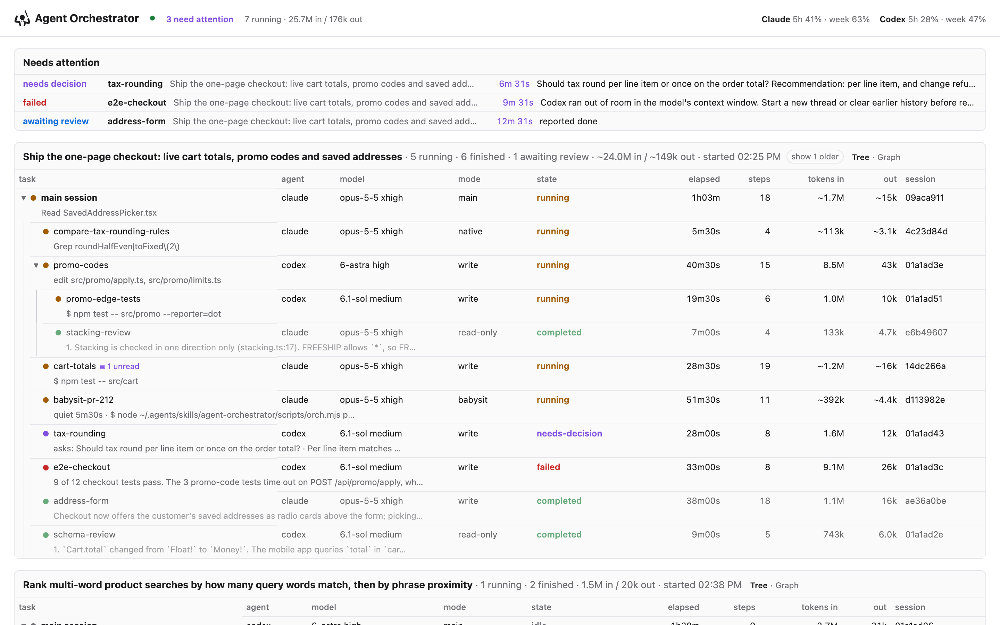
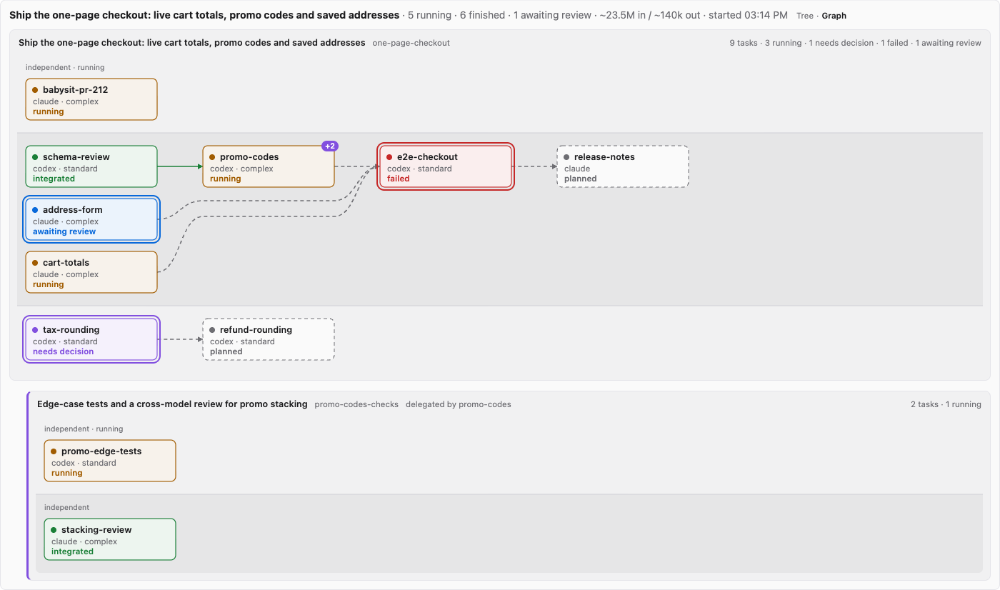
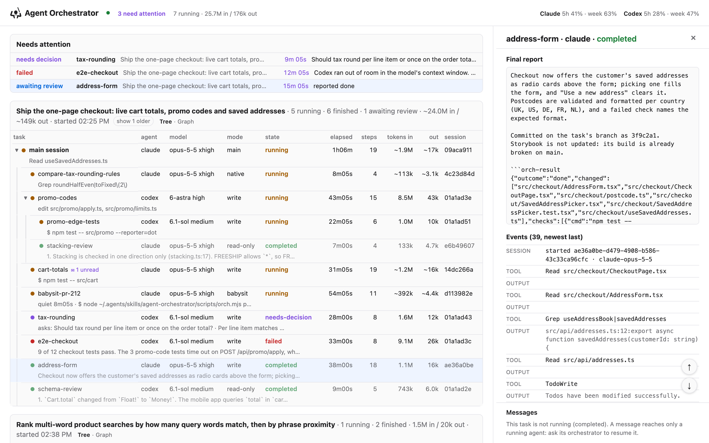
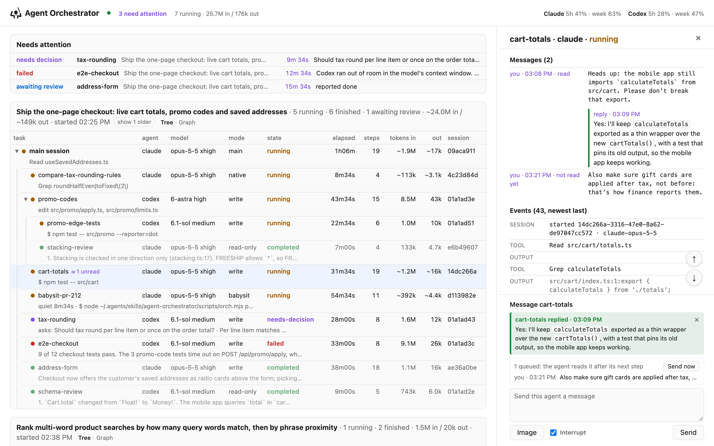
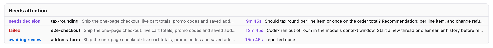

# Agent Orchestrator

Agent Orchestrator runs Claude Code and Codex CLI sessions as background agents on one machine.
An orchestrating session, usually your own Claude Code or Codex session, plans the work, briefs and
dispatches agents (each writer in its own git worktree), then reviews and integrates their results.
Everything shows on a live local dashboard.

Full workflow: [skills/agent-orchestrator/SKILL.md](skills/agent-orchestrator/SKILL.md).

## Screenshots



The board: sessions, their task trees, and the attention lane.



The plan graph: one panel per run, with a lane per chain.



A task's details: final report, review receipts and event log.



Messaging a running agent: its highlighted reply and a queued message.



The attention lane: decisions, failures, results awaiting review and silent tasks.

## Features

- **Plan as data**: a JSON plan of tasks, owned paths and dependencies; `brief` drafts each brief from a template.
- **Dispatch**: `dispatch` starts every ready task up to a parallel limit, each writer in its own worktree.
- **Per-task models**: the orchestrator picks Codex `standard`/`complex` or Claude `light`/`standard`/`complex` per task, Opus when in doubt.
- **Monitoring**: `wait` returns when a task finishes or needs you, `status` lists tasks, `pr-watch` watches pull requests.
- **Review receipts**: `result` matches reported checks to the agent's log, `verify` reruns them, `verdict` records rounds, `accept --note` says why.
- **Messaging**: `send`, `steer` and `reply` talk to a running agent, which waits with `nap` so messages reach it at once.
- **Nested delegation**: agents can start their own agents through the same CLI, with fewer slots at each level.
- **Pull-request babysitting**: a Claude agent watches a pull request's checks and reviews, fixes what is in scope and replies.
- **Dashboard**: task tree and plan graph, attention lane with notifications, stuck-loop detection, and a message box.
- **Outside agents**: headless `codex exec` and `claude -p` agents started by skill scripts appear on the board too.
- **Safety**: permission rules deny force pushes and risky `gh` commands, a kill guard blocks pattern kills, and steering never stops a commit or push.

## Commands

Run `node ~/.agents/skills/agent-orchestrator/scripts/orch.mjs <command>`; `help` prints the full
usage. `RUN` is a run id, a run directory, or `latest`.

| Command | What it does |
| --- | --- |
| `agents` | Agent CLIs, login state, model policy, usage limits |
| `new` | Create a run |
| `plan` | Validate and record the task plan |
| `brief` | Draft a task's brief from its template |
| `lesson` | Record a repository trap that later briefs include |
| `worktree` | Create a worktree and branch for a task |
| `dispatch` | Start every task whose prerequisites are integrated |
| `start` | Launch one agent in the background |
| `wait` | Block until a task finishes, needs attention, or a message arrives |
| `status` | Every task's state, activity and tokens |
| `watch` | Live tree in the terminal |
| `dashboard` | Live tree as a local web page |
| `log` | Tail of a task's relay output |
| `runs` | List runs, newest first |
| `recover` | Read-only summary and next steps after a restart |
| `stats` | Task outcomes by agent, model and type |
| `result` | Final report, checks with evidence, touched files |
| `verify` | Rerun a gate in a finished task's directory |
| `verdict` | Record a review round: clean, changes or reject |
| `accept` | Record a reviewed, committed task as accepted |
| `resolve` | Mark a handed-back decision as handled |
| `integrate` | Merge an accepted task's branch with `--no-ff` |
| `stop` | Terminate a running task |
| `close` | Stop tasks and mark them closed |
| `cleanup` | Remove a run's worktrees |
| `send` | Queue a message for a running agent (`--steer` delivers now) |
| `steer` | Deliver a task's queued messages now |
| `inbox` | A task's unread messages |
| `reply` | An agent's answer to the user's message |
| `nap` | Sleep that returns when a message arrives |
| `pr-watch` | Watch pull requests until one needs you; no model tokens |

## Install

Requires Node.js 18 or newer (22 for the tests), git, `jq`, and Claude Code or Codex CLI logged in;
`gh` for pull-request features. Built on macOS.

```bash
git clone https://github.com/RutvikGupta/agent-orchestrator.git ~/agent-orchestrator
cd ~/agent-orchestrator && ./install.sh
```

`install.sh` links the skills into `~/.agents/skills/` and `~/.claude/skills/`, and the hooks into
`~/.claude/`. It moves anything in the way to `~/.agents/backups/`. Because these are links, changes
to the checkout reach every session at once.

It does not edit settings. Merge them yourself:

- `integrations/claude/settings.example.json` into `~/.claude/settings.json`;
- `integrations/codex/hooks.example.json` into `~/.codex/hooks.json`.

The hooks block pattern kills, deliver messages to running agents, start the dashboard, and tell new
sessions to load the skill. Leave out any you do not want.

Check the agents and open the dashboard:

```bash
node ~/.agents/skills/agent-orchestrator/scripts/orch.mjs agents --refresh
node ~/.agents/skills/agent-orchestrator/scripts/orch.mjs dashboard --detach --open
```

## Layout

```text
skills/
  agent-orchestrator/   the skill: SKILL.md, CLI (scripts/orch.mjs), dashboard, tests
  claude-delegate/      relay that runs one Claude Code session
  codex-delegate/       relay that runs one Codex session
integrations/           hooks, browser agent, MCP server definition, example settings
docs/                   screenshots and the demo board used to make them
install.sh              links the skills and hooks into place
```

## Development

- Run the tests: `cd skills/agent-orchestrator && env -u AGENT_ORCH_DEPTH -u AGENT_ORCH_RUN -u AGENT_ORCH_TASK node --test tests/`.
- Commit and push every change to `main` (merge branches with `--no-ff`, never force-push). Read `AGENTS.md` first.
- Keep the repository free of employer or customer names and of secrets.

## Credits

The delegate skills come from the MIT-licensed
[delegate-skills](https://github.com/amElnagdy/delegate-skills) project. The Claude relay carries a
local patch (`skills/agent-orchestrator/references/claude-delegate-network.patch`) for network,
sandbox and publishing options.
